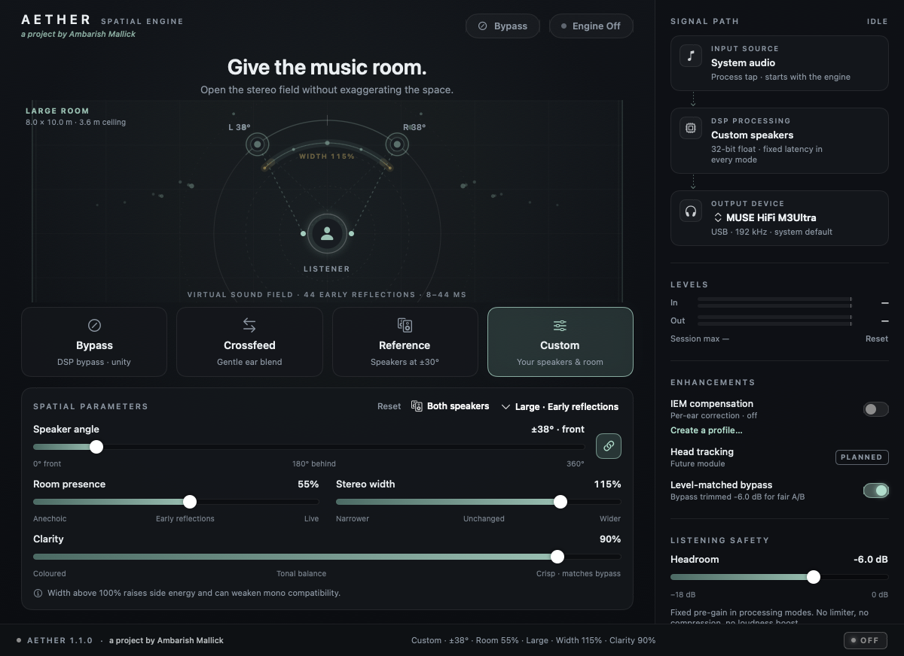
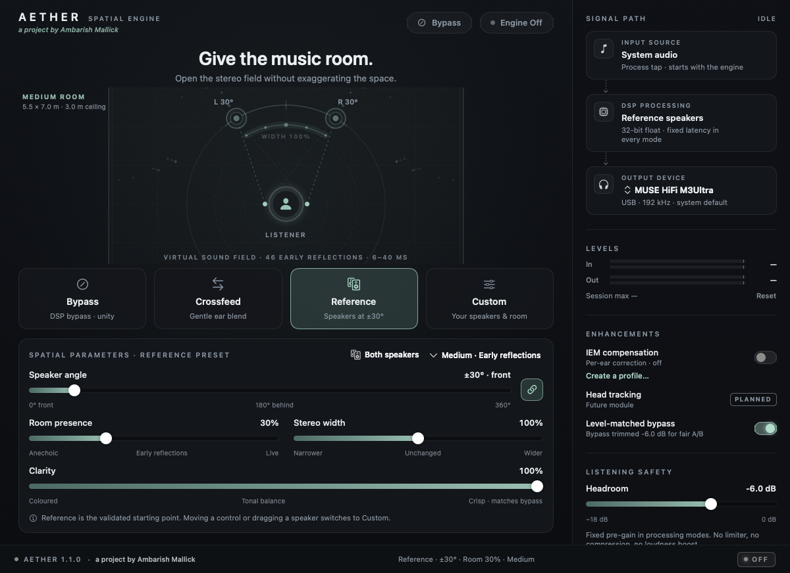
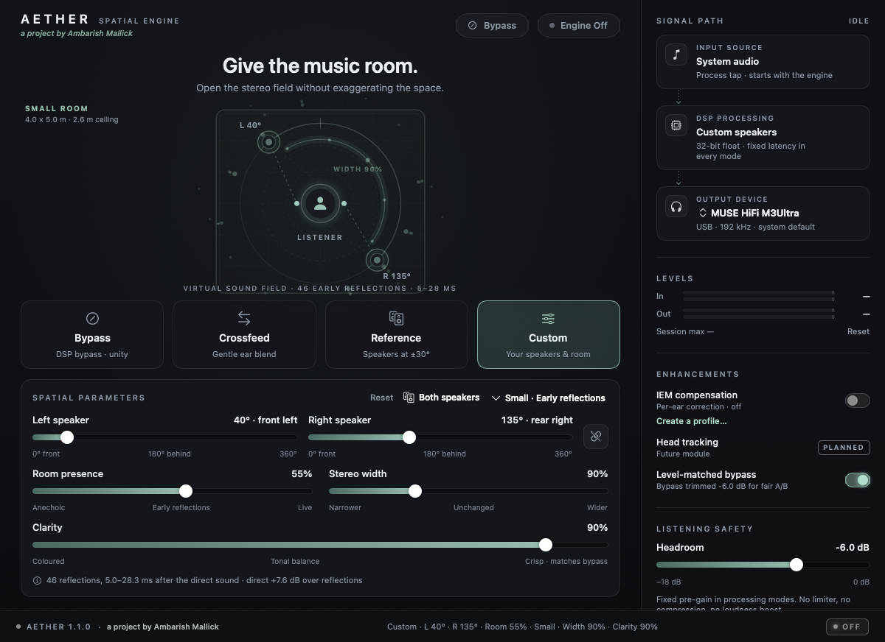
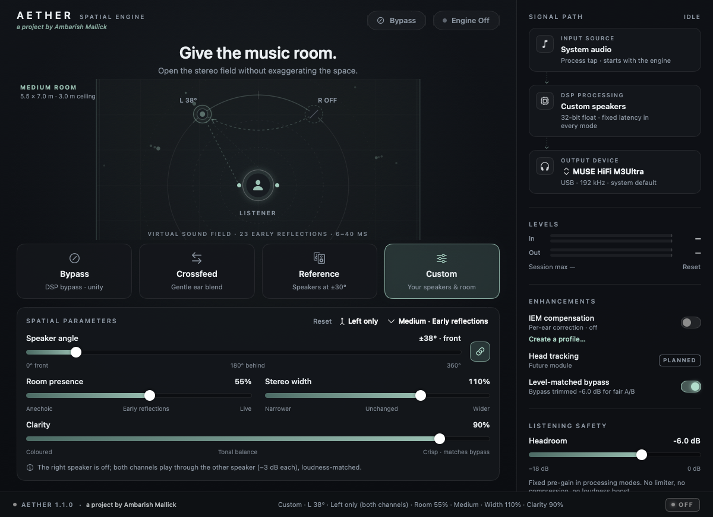

# Aether

**IEM soundstage spatializer for macOS** — *a project by Ambarish Mallick*

[](../../releases/latest)


[](LICENSE)



Aether makes ordinary stereo through wired in-ear monitors feel more like two loudspeakers in front of you: externalised, with a stable centre and natural width, without washing the sound out. It processes the system mix in real time, so it works with Apple Music, Spotify, browsers and local players. One keystroke (⌘B) returns you to an unprocessed DSP bypass.

> Wider, more externalised playback requires changing the samples sent to the DAC. Aether keeps the path in 32-bit float with fixed headroom and no hidden compression. While DSP is on, the output is not bit-identical to the source, and Aether never claims it is.

### Highlights

- **System-wide.** A private Core Audio process tap feeds your DAC directly, with no virtual driver to install.
- **Virtual speakers** on a structural HRTF head model, with image-source early reflections in small, medium or large rooms.
- **Clarity.** Keeps IEMs crisp: the tonal balance matches bypass within ±1.5 dB, with interaural cues untouched.
- **Free placement.** Put each speaker anywhere on the full 360° circle, linked or independent, by dragging it in the sound field. Either speaker can be switched off, optionally folding its channel into the other.
- **Honest A/B.** Every mode is loudness-matched to bypass. Latency is fixed across modes, and switching is click-free.
- **Fast and light.** Under 1% of one CPU core at 192 kHz.
- **IEM profiles.** User-tuned EQ, model estimates or your own measurements, kept per ear.

| Reference | Independent speakers, small room | One speaker, channel folded in |
|---|---|---|
|  |  |  |

## What is in this repository

| Part | Path | Status |
|---|---|---|
| Portable DSP core (C++20, versioned C ABI) | `core/` | Working; 156 automated checks, clean under ASan/UBSan |
| Offline reference renderer (WAV in → WAV out) | `tools/aether-render/` | Working |
| CPU benchmark | `benchmarks/` | Working |
| macOS system-audio route (Core Audio process tap + private aggregate device) | `platform/macos/` | Working on macOS 27.2 with a USB DAC at 192 kHz |
| macOS app (SwiftUI) | `apps/macos/Aether/` | Working |
| macOS HAL virtual-device driver (spec's production route) | — | Not started — see `docs/routing-macos.md` |
| Windows virtual endpoint, WASAPI bridge and app | — | Not started — see `docs/routing-windows.md` |
| Licensed measured HRTF dataset / SOFA importer | — | Not bundled; an analytic head model is used instead (see below) |
| Perceptual listening study (spec §7.3) | — | Not run |

The spec's Definition of Done is tracked item by item in [`docs/release-checklist.md`](docs/release-checklist.md).

## How it works

```
apps → macOS shared mix ─► private process tap (all processes except Aether,
                           original output muted only while Aether reads it)
                         ─► private aggregate device {tap + your DAC}, one clock,
                           Core Audio drift compensation / rate conversion
                         ─► IOProc → DSP core (2×2 partitioned FIR, float32)
                         ─► your DAC's preferred stereo channels → IEMs
```

Every processing mode compiles, off the audio thread, into one immutable **2×2 FIR matrix**. That matrix already contains the mid/side width stage, the spatial renderer (HRTF virtual speakers plus early room reflections, or a crossfeed), the optional per-ear IEM correction, and the headroom gain. The audio thread runs uniformly partitioned overlap-save convolution with a shared input frequency-domain delay line. On a change it crossfades over 50 ms between the old and new banks. Every mode, bypass included, has the same fixed latency (B + 2 ms; 7.3 ms at 48 kHz), so switches stay time-aligned and click-free.

Modes:

- **Bypass**: DSP bypass. Unity gain, channel order preserved, delay-compensated, bit-exact after the declared latency. An optional level-matched compare (on by default) trims it by the headroom value for fair A/B listening.
- **Crossfeed**: shelving crossfeed (`D = (1+g) − g·LP`, `C = g·LP·z^−d`). Centre-mono stays flat; hard pans get a low-passed cross-ear signal.
- **Reference**: virtual speakers at ±30°, a medium room at 30% early reflections, width 1.0, full clarity, −6 dB headroom.
- **Custom**: speakers anywhere on the full circle (0–360°, measured from the front toward each speaker's own side), linked (one symmetric angle) or unlinked (independent left and right angles, set by slider or by dragging a speaker in the sound field); either speaker can be switched off (the Speakers menu, or right-click in the sound field), optionally playing the muted channel through the remaining speaker; room presence 0–100%; room size; width 0.75–1.25; clarity 0–100%.

The sound field shows what is being rendered:
- **Room.** The selected room is drawn as a floor plan with a 1 m grid, so small, medium and large rooms are visibly different sizes.
- **Width.** The stereo image is drawn as a band between the speakers that narrows or spreads with the width control. Anything pushed beyond the speakers is drawn in amber.
- **Switched-off speakers.** These are drawn as a dashed outline. When the muted channel is folded into the other speaker, an arrow shows where it goes.

**Clarity.** Two virtual speakers on a head model add their own tone: bass builds up where the two paths sum coherently, the far ear's head shadow removes treble, and the pinna model cuts a notch near 6 kHz. Through IEMs that reads as muffled. Clarity applies one correction, identical for both ears, that returns the overall tonal balance to that of bypass (⅙-octave smoothed). Interaural time and level differences, which carry the spatial image, are left untouched (tested to 0.002 dB). Speakers placed behind you keep a slightly darker tone on purpose, because that is the cue that puts them behind.

**HRTF model.** The spec requires a licensed, attributed dataset before bundling measured HRTFs, so Aether ships with an *analytic* structural model instead: Brown & Duda's spherical-head shadow and ITD, plus a tempered pinna-echo model. It is diffuse-field equalised, so it carries no dataset licence obligations. A SOFA importer is future work. Early reflections come from an image-source model (orders 1–2), each rendered through the HRTF from its own direction. That gives real interaural differences, not one shared reverb.

All modes are **loudness-matched**: K-weighted (BS.1770 curve) pink-spectrum power, averaged over correlated and uncorrelated stereo, matches bypass. Measured spread is within 0.13 dB, including asymmetric, rear, side-swapped and single-speaker layouts.

## Install

Download **`Aether-1.1.0.dmg`** from [Releases](../../releases/latest) (one file, about 4 MB; universal for Apple silicon and Intel; macOS 14.4 or later). Then:

1. Open the disk image and drag **Aether** onto **Applications**. If you open Aether straight from the disk image instead, it offers to move itself to Applications.
2. Open Aether from Applications. If macOS says it can't verify the developer, go to **System Settings › Privacy & Security**, scroll down and click **Open Anyway**. You only need to do this once. It is required because this build is not yet signed with an Apple Developer ID (see below).
3. Press **Engine On** and allow **System Audio Recording** when asked. Play music, then pick a mode. ⌘B toggles bypass.

To check the download, compare its SHA-256 with `Aether-1.1.0.dmg.sha256`:

```bash
shasum -a 256 Aether-1.1.0.dmg
```

**Uninstall:** quit Aether and move it to the Trash. Optionally delete `~/Library/Application Support/Aether` (settings and IEM profiles). Aether installs no drivers, daemons or system extensions, so nothing else is left behind.

## Build

Requirements: macOS 14.4+ (process taps), Command Line Tools or Xcode, CMake 3.20+.

```bash
./scripts/test-core
```
Builds the core and runs all tests in release and under AddressSanitizer + UBSan.

```bash
./scripts/build-macos
```
Builds `dist/Aether.app`: a universal binary (arm64 + x86_64) with hardened runtime. The version comes from `VERSION`.

```bash
./scripts/package-macos
```
Builds the installer `dist/Aether-<version>.dmg` and its `.sha256`. The image holds the app, an Applications shortcut, a styled window with install instructions, and a volume icon. The window layout uses Finder, which may ask once for Automation permission. Without that permission the image still works, just unstyled.

For a release that opens with no Gatekeeper prompt, sign with a Developer ID and notarize. `notarytool store-credentials` is a one-time setup with your Apple ID.

```bash
xcrun notarytool store-credentials aether-notary --apple-id you@example.com --team-id TEAMID
```

```bash
AETHER_SIGN_IDENTITY="Developer ID Application: Your Name (TEAMID)" AETHER_NOTARY_PROFILE=aether-notary ./scripts/package-macos
```

```bash
./scripts/run-benchmarks
```
Prints the DSP core's CPU cost on this machine.

```bash
open dist/Aether.app
```

The first time you press **Engine On**, macOS asks to allow *System Audio Recording* for Aether. Audio is processed in real time only. It is never recorded, stored, identified or sent.

### Route self-test

```bash
open -W -n dist/Aether.app --args --selftest /tmp/aether-selftest.json
```
Starts the real route on the system default output, plays a quiet −40 dBFS tone from a separate process, switches modes live, and writes a JSON report (formats, rates, callbacks, overloads, load, levels).

### Offline renderer

```bash
./build/aether-render in.wav out.wav --mode reference
./build/aether-render in.wav out.wav --mode custom --azimuth 40 --room 0.5 --width 1.1 --iem 2,0,-1
./build/aether-render in.wav out.wav --mode custom --left 30 --right 20 --clarity 1
./build/aether-render in.wav out.wav --mode custom --off left --fold 1
```
Uses the same core as the app, compensates latency, and writes 32-bit float WAV with peak and true-peak readouts. Use it to A/B presets offline or to verify output against the app.

## Using it well

- In Apple Music, set **Dolby Atmos → Off** so Aether receives plain stereo and nothing is spatialised twice.
- Use a wired DAC. Bluetooth/AirPlay codecs re-encode after Aether, and the app warns you.
- Keep **Headroom** at −6 dB unless the Out meter shows plenty of margin. Aether never limits or compresses.
- Apps that take exclusive (hog-mode) control of the DAC, protected streams, and remote playback (Spotify Connect, AirPlay to another device) can bypass Aether. The status badge then shows **Not processing**.

## Repository layout

```
core/include/aether/aether_core.h   C ABI (versioned)
core/src/                           engine, filter design, FFT
core/tests/test_core.cpp            unit/property tests
tools/aether-render/                offline renderer
benchmarks/                         CPU benchmark
platform/macos/                     Core Audio route (Objective-C++)
apps/macos/Aether/                  SwiftUI app
assets/hrtf-manifest.json           provenance of the spatial model
packaging/Aether.entitlements       hardened-runtime entitlements
LICENSE                             MIT
VERSION                             release version (app, installer)
docs/                               architecture, DSP math, routing, tests, release checklist, release notes
scripts/                            bootstrap, build-core, test-core, build-macos, package-macos, run-benchmarks, check-package
```

## Developer

Aether is designed and developed by **Ambarish Mallick** ([@ambarish-mallick](https://github.com/ambarish-mallick)).

Bug reports and ideas are welcome in [Issues](../../issues).

## License

MIT © 2026 Ambarish Mallick. See [LICENSE](LICENSE).

---
Aether · a project by Ambarish Mallick
